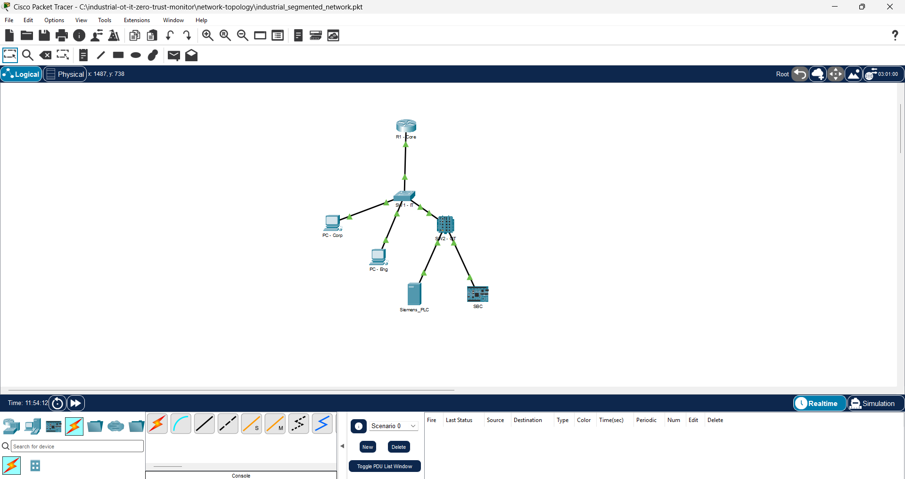
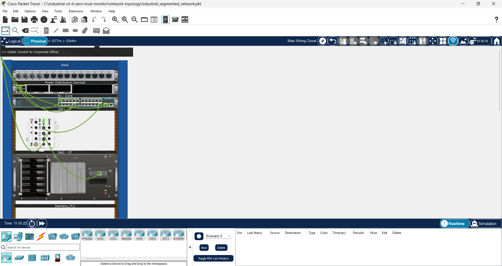

# OT/IT Zero-Trust Network & SBC SCADA Health Monitor

A hybrid Proof-of-Concept demonstrating secure industrial Operational Technology (OT) and enterprise IT integration following the Purdue Enterprise Reference Architecture (IEC 62443). The project combines network segmentation with an edge SCADA health-monitoring daemon.

---

## 1. Network Architecture (Cisco Packet Tracer)

The network is structured into isolated zones to protect critical shopfloor assets from corporate vulnerabilities:
* **VLAN 10 (Corporate):** Isolated business workstations with internet access; denied from accessing the OT floor.
* **VLAN 20 (Engineering):** Secure maintenance workstation authorized to communicate with field devices.
* **VLAN 30 (Shopfloor / OT):** Dedicated industrial subnet hosting Siemens PLCs, Single Board Computers (SBC), and Cisco IE 2000 industrial switching equipment.

### Logical Topology

*Figure 1: Layer 3 Router-on-a-Stick segmentation and VLAN assignment.*

### Simulated Physical Rack Deployment

*Figure 2: Simulated physical rack deployment with Cisco IE 2000 industrial switch and PLC rack.*

---

## 2. Security & Access Control Enforcement

A Layer 3 Extended Access Control List (ACL) is deployed on the corporate sub-interface (`gig0/0/0.10`) to silently drop unauthorized lateral traffic before it consumes routing CPU cycles:

```text
access-list 100 deny ip 192.168.10.0 0.0.0.255 10.10.30.0 0.0.0.255
access-list 100 permit ip any any
```
